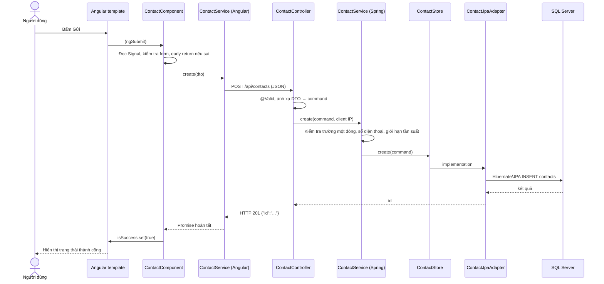

# Mẫu triển khai Angular → Spring Boot → SQL Server

## Luồng yêu cầu



Template dùng `{{ officeAddress() }}` để hiển thị giá trị Signal, `(ngSubmit)` và `(click)` để chuyển sự kiện vào Component. Component quản lý trạng thái giao diện và kiểm tra sớm bằng `return`; HTTP chỉ nằm trong Angular Service. Khi admin cập nhật trạng thái, `ContactService.contacts` là Signal chỉ đọc; Service cập nhật nó **sau khi** server trả về thành công. Các `computed` như `pendingCount` và bảng lọc tự tính lại, Angular cập nhật giao diện.

## Ranh giới backend

| Lớp | Trách nhiệm | Tệp mẫu |
| --- | --- | --- |
| Controller + DTO | Đường dẫn HTTP, JSON, `@Valid`, mã trạng thái | `ContactController`, `controller/dto/*` |
| Application Service | Quy tắc nghiệp vụ, early return, transaction | `ContactService`, `service/command/*` |
| Port | Hợp đồng lưu trữ mà Service cần | `service/port/ContactStore` |
| JPA adapter + Entity | Ánh xạ domain sang bảng `contacts`, dùng Hibernate/JPA | `ContactJpaAdapter`, `ContactJpaRepository`, `ContactEntity` |
| Domain | Dữ liệu độc lập với HTTP và JPA | `domain/Contact` |

Hướng phụ thuộc của phần liên hệ là Controller → Service → Port ← JPA adapter. Entity JPA nằm phía lưu trữ; Service không gọi `JpaRepository` và không phụ thuộc DTO HTTP. Spring Security xác thực JWT cho `/api/admin/**`. `ApiErrors` ánh xạ lỗi nghiệp vụ thành JSON `{ "message": "..." }`.

**Phạm vi hiện tại:** phần liên hệ là mẫu đã chuyển sang JPA. Các chức năng bài viết, trang, analytics, tài khoản và hỗ trợ vẫn dùng `JdbcTemplate`/`Map` trong repository cũ. Khi chuyển từng chức năng, giữ API contract, tách domain/port/adapter tương tự, rồi bỏ truy vấn JDBC của chức năng đó. Không coi toàn bộ backend hiện tại đã chuyển sang JPA.

## API contract liên hệ

Chốt contract này trước khi sửa Controller hoặc Angular model. Mọi field JSON dùng camelCase, timestamp là UTC ISO 8601, `Content-Type: application/json`.

| Method | URL | Quyền | Request | Response |
| --- | --- | --- | --- | --- |
| `POST` | `/api/contacts` | Công khai, giới hạn 3 lần/IP/phút | `CreateContactRequest` | `201 {"id":"uuid"}` |
| `GET` | `/api/admin/contacts?size=20` | Bearer token admin | `status`, `search`, `cursor`, `size` tùy chọn | `200 {items,size,hasMore,nextCursor}` |
| `GET` | `/api/admin/bootstrap` | Bearer token admin | — | `200 {summary:{...}}`, chỉ số liệu tổng hợp |
| `PUT` | `/api/admin/contacts/{id}` | Bearer token admin | `{"status":"CONTACTED","adminNotes":"..."}` | `200 Contact` |

`CreateContactRequest` gồm `fullName`, `email`, `phone`, `projectType`, `budgetRange`, `message` bắt buộc và `companyName` tùy chọn. Backend kiểm tra độ dài, email, số điện thoại 7–15 chữ số và ký tự điều khiển. Các trường tên và lựa chọn chỉ nhận một dòng; `message` có thể xuống dòng. `status` chỉ nhận `NEW`, `CONTACTED`, `IN_PROGRESS`, `CLOSED`. Dữ liệu sai trả `400`; ID không tồn tại trả `404`; vượt giới hạn trả `429` kèm `Retry-After: 60`. Contact response có thêm `id`, `status`, `adminNotes`, `createdAt`, `updatedAt`.

Ví dụ:

```http
POST /api/contacts
Content-Type: application/json

{"fullName":"Nguyễn Văn A","email":"a@example.com","phone":"+84 900 123 456","companyName":"Yin","projectType":"Web","budgetRange":"200M - 500M","message":"Tôi cần tư vấn hệ thống."}
```

## SQL Server, CORS và vận hành

`schema.sql` tạo bảng và chỉ mục; `spring.jpa.hibernate.ddl-auto=none` nên Hibernate không tự sửa schema. `ContactEntity` ánh xạ các cột hiện có; thời gian được ghi UTC. Khi đổi cấu trúc bảng cho môi trường đã có dữ liệu, cần migration SQL có kiểm soát. Repository JDBC cũ đã được đồng bộ với `schema.sql` ở các cột `pages.title`, `pages.content_json` và `page_views.viewed_at`.

Angular dev server proxy `/api` sang backend; Nginx cũng proxy `/api` trong Docker. Hai cách này dùng cùng origin, nên trình duyệt không cần CORS. Nếu gọi trực tiếp backend từ một origin khác, đặt origin đó trong `CORS_ALLOWED_ORIGINS` (danh sách URL phân cách bằng dấu phẩy). Spring Security bật CORS và chỉ cho phép origin cấu hình trên `/api/**`; mặc định là `http://localhost:4200` và `http://127.0.0.1:4200`. Không dùng wildcard với API quản trị.

## Quy trình áp dụng cho CRUD tiếp theo

1. Viết contract: route, quyền, JSON, validation, lỗi và trạng thái HTTP; đồng bộ TypeScript model.
2. Tạo domain + port cho nghiệp vụ, rồi cài repository/Entity ở lớp lưu trữ.
3. Đặt validation request ở Controller; đặt quy tắc nghiệp vụ ở Service. Dùng early return/guard clause cho đầu vào sai, không lồng nhiều nhánh.
4. Đặt HttpClient trong Angular Service; Component chỉ nhận sự kiện, đọc/ghi Signal và hiển thị trạng thái.
5. Kiểm tra Service, HTTP/Signal, build frontend và migration với SQL Server trước khi giao team.

Contact là bài tập tạo, đọc qua endpoint danh sách và cập nhật trạng thái. Không có endpoint xóa liên hệ vì đây là hồ sơ khách hàng cần lưu lại; trạng thái `CLOSED` kết thúc vòng đời hiện tại.
